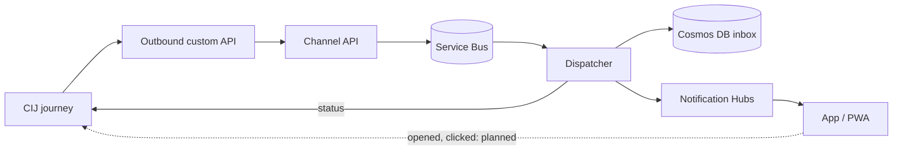

# Push + Inbox custom channel for Dynamics 365 Customer Insights - Journeys

Customer Insights - Journeys (CIJ) can send push notifications, but its native push channel has no persistent in-app inbox. This solution adds a CIJ **custom channel**, *Push + Inbox*. One journey tile sends a push alert, an inbox message that stays in the app's message center until it expires, or both. The backend is Azure: Functions, Service Bus, Cosmos DB and Notification Hubs.

- **Delivery modes:** *Alert + Inbox*, *Inbox only* or *Alert only*, chosen per message.
- **Reporting:** delivery status (`Delivered` / `NotDelivered`) is reported back to CIJ. *Delivered* means the inbox item was stored or Notification Hubs accepted the push, not that a device displayed it. Inbox *opened* and *clicked* events aren't reported to CIJ yet; they are planned as custom triggers ([roadmap](#roadmap)).
- **Platforms:** web push (PWA) today, through Azure Notification Hubs. Android (FCM) and iOS (APNs) device registration is planned.
- **Languages:** full English and Hebrew, including right-to-left.
- **Installation:** a single Dataverse solution plus a post-import script, and an `azd` template for Azure.



## Status

| Part | Status |
|---|---|
| Dataverse solution `AlexPushInboxChannel` 1.0.0.0: channel definition, 7 message parts, config table and form, custom APIs, plug-ins, environment variable, English and Hebrew labels | Available |
| Azure backend (`azd up`): Channel API with idempotency, Service Bus, Dispatcher, Cosmos DB inbox, Notification Hubs Web Push, delivery reports to CIJ | Available (preview) |
| Reference PWA inbox (Static Web Apps) and Inbox API | Available as a **test harness**: the Inbox API is anonymous. See [known limitations](docs/known-limitations.md). |
| End-user authentication, interaction triggers, Android/iOS device registration, Dataverse message log | Planned (see roadmap) |

## Documentation

- [Installation](docs/installation.md)
- [Configuration](docs/configuration.md)
- [Architecture](docs/architecture.md)
- [Data model reference](docs/data-model.md)
- [Localization (English / Hebrew, RTL)](docs/localization.md)
- [Design choices](docs/design-choices.md)
- [Known limitations](docs/known-limitations.md)
- [Security considerations](docs/security.md)
- [Production sizing](docs/production-sizing.md)
- [Developer integration (customer apps)](docs/developer-integration.md)
- [Contributing](CONTRIBUTING.md)

## Repository layout

```text
solution/AlexPushInboxChannel/   Dataverse solution source (pac solution unpack format)
solution/src/                    Plug-in source (.NET Framework 4.8)
deploy/post-import.sh            Grants CIJ read access to the channel configuration
deploy/connect-azure.sh          Connects Dataverse to the Azure backend after azd up
azure.yaml, infra/               azd template (Bicep)
src/PushInbox.Functions/         Azure Functions: Channel API, Dispatcher, Inbox API (.NET 10 isolated)
src/web/                         Reference PWA inbox (Web Push)
tools/l10n/                      Translation export, fill, import and verify
tests/solution/                  Solution structure and label check
.githooks/                       Pre-commit hook (enable with tools/setup-hooks.sh)
```

## Roadmap

1. **Done (preview):** Azure core and Web Push. Channel API with idempotency, Service Bus, Dispatcher, Cosmos DB inbox, Notification Hubs, delivery reports to CIJ, reference PWA, `azd up`.
2. **Required – Dataverse message log:** one row per message and status change in an elastic table, for audit and reporting. The schema is in [data-model.md](docs/data-model.md#planned-message-log-elastic-table). Where it appears in the UI is not decided yet.
3. **Security:** authenticated Inbox API (end-user identity instead of `recipientKey` in the query string), Power Platform managed identity for the plug-in instead of the function key, solution security roles.
4. **Interactions:** inbox opened and clicked events as CIJ custom triggers; `replaceKey`.
5. **Images:** pick the image from the CIJ asset library instead of typing a URL.
6. **Mobile apps:** Android (FCM v1) and iOS (APNs) device registration in the Inbox API; [developer integration guide](docs/developer-integration.md).
7. **Release:** managed solution, sample journey, retry and dead-letter alerting, delete by recipient.

## License

[MIT](LICENSE).
