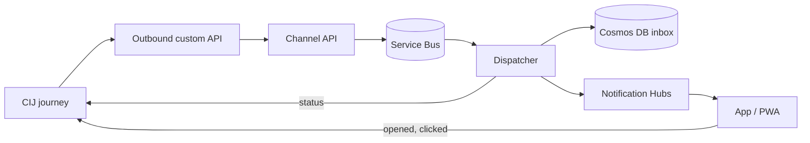

# Push + Inbox custom channel for Dynamics 365 Customer Insights - Journeys

Customer Insights - Journeys (CIJ) can send push notifications, but its native push channel has no persistent in-app inbox. This solution adds a CIJ **custom channel**, *Push + Inbox*. One journey tile sends a push alert, an inbox message that stays in the app's message center until it expires, or both. The backend is Azure: Functions, Service Bus, Cosmos DB and Notification Hubs.

- **Delivery modes:** *Alert + Inbox*, *Inbox only* or *Alert only*, chosen per message.
- **Reporting:** delivery status flows back to CIJ analytics, and inbox *opened* and *clicked* events can drive journey branches.
- **Platforms:** web (PWA), Android (FCM) and iOS (APNs), through Azure Notification Hubs.
- **Languages:** full English and Hebrew, including right-to-left.
- **Installation:** a single Dataverse solution plus a post-import script, and an `azd` template for Azure (planned).



## Status

| Part | Status |
|---|---|
| Dataverse solution `AlexPushInboxChannel` 1.0.0.0: channel definition, 7 message parts, config table and form, custom APIs, plug-in, environment variable, English and Hebrew labels | Available |
| Azure backend, reference PWA inbox, `azd` template | Planned |

Until the backend is deployed, sends return `NotSent` (`ChannelApiNotConfigured`).

## Documentation

- [Installation](docs/installation.md)
- [Configuration](docs/configuration.md)
- [Architecture](docs/architecture.md)
- [Data model reference](docs/data-model.md)
- [Localization (English / Hebrew, RTL)](docs/localization.md)
- [Design choices](docs/design-choices.md)
- [Known limitations](docs/known-limitations.md)
- [Contributing](CONTRIBUTING.md)

## Repository layout

```text
solution/AlexPushInboxChannel/   Dataverse solution source (pac solution unpack format)
solution/src/                    Plug-in source (.NET Framework 4.8)
deploy/post-import.sh            Grants CIJ read access to the channel configuration
tools/l10n/                      Translation export, fill, import and verify
tests/solution/                  Solution structure and label check
.githooks/                       Pre-commit hook (enable with tools/setup-hooks.sh)
```

## Roadmap

1. **Azure core:** Channel API with idempotency, Service Bus, Dispatcher, Cosmos DB inbox, delivery reports to CIJ, deployed with `azd up`.
2. **Push and reference client:** Notification Hubs, Inbox API, and a PWA inbox tested end to end in a desktop browser.
3. **Interactions:** inbox opened, clicked and dismissed events as CIJ custom triggers; `replaceKey` and expiry.
4. **Hardening:** Power Platform managed identity for the plug-in, solution security roles, retry and dead-letter alerting, delete by recipient.
5. **Release:** managed solution, integration guide for Android and iOS apps, sample journey.
