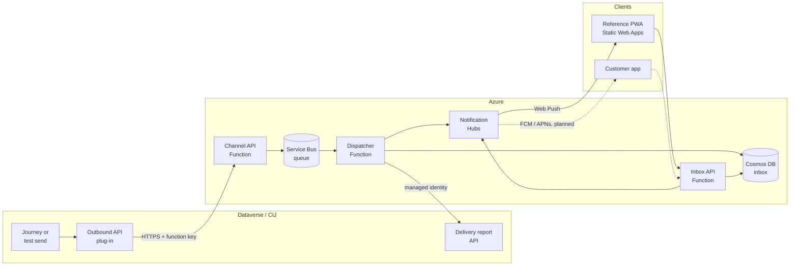
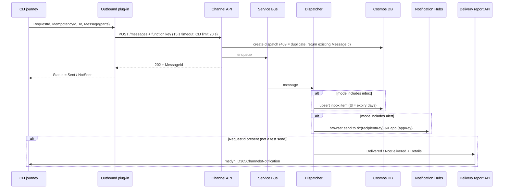
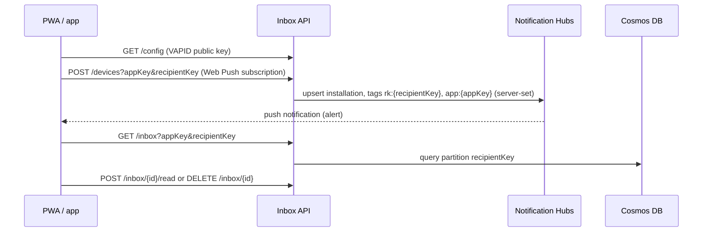

# Architecture

Why each component was chosen: [design-choices.md](design-choices.md). Data details: [data-model.md](data-model.md).

Dashed lines are not implemented yet. Key Vault, Application Insights, the virtual network and the network security perimeter are cross-cutting, so they appear only in the tables below.

## Components

| Component | Role | Tier as deployed | Source |
|---|---|---|---|
| CIJ custom channel solution | Channel definition, message parts, instance config table, custom APIs | Managed solution | ([Custom channels in CIJ](https://learn.microsoft.com/dynamics365/customer-insights/journeys/real-time-marketing-extend-outreach-custom-channels), [Channel definition](https://learn.microsoft.com/dynamics365/customer-insights/journeys/real-time-marketing-define-channel-definition), [Message parts](https://learn.microsoft.com/dynamics365/customer-insights/journeys/real-time-marketing-custom-channel-message-parts)) |
| Outbound custom API plug-in (`alex_PushOutbound`) | Maps the CIJ payload, POSTs it to `POST /messages` with the instance's function key (15 s timeout), returns `Sent` or `NotSent` | Dataverse sandbox | ([Custom channel custom APIs](https://learn.microsoft.com/dynamics365/customer-insights/journeys/real-time-marketing-custom-channel-custom-api), [Plug-in external call timeout](https://learn.microsoft.com/power-apps/developer/data-platform/best-practices/business-logic/set-timeout-for-external-calls-from-plug-ins)) |
| Delivery-report custom API (`alex_PushDeliveryReport`) | Called by the Dispatcher; calls `msdyn_D365ChannelsNotification` | Dataverse | ([Custom channel custom APIs](https://learn.microsoft.com/dynamics365/customer-insights/journeys/real-time-marketing-custom-channel-custom-api)) |
| Channel API (Function, HTTP, function key) | Validates, de-duplicates on `IdempotencyId` (generates one when CIJ sends it empty), enqueues, returns 202 | Flex Consumption | ([Function access keys](https://learn.microsoft.com/azure/azure-functions/function-keys-how-to)) |
| Service Bus queue `dispatch` | Buffers, retries, dead-letter queue. Local (SAS) auth disabled. | Basic | ([Service Bus overview](https://learn.microsoft.com/azure/service-bus-messaging/service-bus-messaging-overview)) |
| Dispatcher (Function, queue trigger) | Writes the inbox item, sends the browser push, calls the delivery-report API (non-test sends only) | Flex Consumption | ([Notification Hubs browser push](https://learn.microsoft.com/azure/notification-hubs/browser-push)) |
| Cosmos DB for NoSQL | `inboxItems` (partition `/recipientKey`, per-item TTL = expiry days) and `dispatches` (partition `/idempotencyId`, TTL 30 days). Public access disabled; Entra-only data access. | Serverless | ([Cosmos DB time to live](https://learn.microsoft.com/azure/cosmos-db/how-to-time-to-live), [Cosmos DB RBAC](https://learn.microsoft.com/azure/cosmos-db/nosql/security/how-to-grant-data-plane-role-based-access)) |
| Azure Notification Hubs | Tag-based browser (Web Push) send; `?test` debug send for CIJ test sends. VAPID keys are stored in the hub's browser credential. | Free | ([Notification Hubs browser push](https://learn.microsoft.com/azure/notification-hubs/browser-push), [Installations](https://learn.microsoft.com/azure/notification-hubs/notification-hubs-push-notification-registration-management), [Pricing](https://azure.microsoft.com/pricing/details/notification-hubs/)) |
| Inbox API (Function, HTTP, **anonymous**) | `GET /config`, `POST /devices` (browser subscription), `GET /inbox`, `POST /inbox/{id}/read`, `DELETE /inbox/{id}`. Identifies the user by `appKey` + `recipientKey` query values. See [known limitations](known-limitations.md). | Flex Consumption | ([Installations](https://learn.microsoft.com/azure/notification-hubs/notification-hubs-push-notification-registration-management)) |
| Key Vault | Holds the Notification Hubs connection string, read through a Key Vault reference. Public access disabled; RBAC. | Standard | ([Key Vault references](https://learn.microsoft.com/azure/app-service/app-service-key-vault-references)) |
| Storage account | Function host storage and deployment package; shared-key access disabled; reached through the network security perimeter | Standard LRS | ([Storage and NSP](https://learn.microsoft.com/azure/storage/common/storage-network-security-perimeter)) |
| Virtual network, private endpoints, NSP | Function VNet integration; private endpoints for Cosmos DB, Key Vault and blob; NSP for storage | — | ([Flex Consumption VNet integration](https://learn.microsoft.com/azure/azure-functions/flex-consumption-plan#virtual-network-integration), [Private endpoints](https://learn.microsoft.com/azure/private-link/private-endpoint-overview)) |
| Application Insights + Log Analytics | Traces; recipient keys are logged only as a SHA-256 prefix | Pay-as-you-go, 30-day retention | — |
| Static Web Apps | Hosts the reference PWA (subscribe, inbox, mark read, delete) | Free | ([Static Web Apps](https://learn.microsoft.com/azure/static-web-apps/overview)) |
| Function managed identity | Azure data-plane roles, and a Dataverse application user (Basic User) for delivery reports | System-assigned | ([Managed identities](https://learn.microsoft.com/entra/identity/managed-identities-azure-resources/overview), [Application users](https://learn.microsoft.com/power-platform/admin/manage-application-users)) |
| azd + Bicep, pac CLI | Replicable provisioning and solution packaging | — | ([azd for Azure Functions](https://learn.microsoft.com/azure/developer/azure-developer-cli/function-app-deployments), [SolutionPackager](https://learn.microsoft.com/power-platform/alm/solution-packager-tool)) |

### Azure role assignments for the Function identity

| Scope | Role |
|---|---|
| Storage account | Storage Blob Data Owner, Storage Queue Data Contributor, Storage Table Data Contributor (Functions host requirement) |
| Service Bus namespace | Azure Service Bus Data Sender, Azure Service Bus Data Receiver |
| Key Vault | Key Vault Secrets User |
| Cosmos DB account | Cosmos DB Built-in Data Contributor (data plane) |

Source: [identity-based connections for Functions](https://learn.microsoft.com/azure/azure-functions/functions-reference#common-properties-for-identity-based-connections).

## Send flow

| Status | When |
|---|---|
| `Sent` | The Channel API returned 202. |
| `NotSent` | Validation failure or 4xx. Not retried. |
| `Delivered` | The inbox write succeeded, or Notification Hubs reported at least one successful send. |
| `NotDelivered` | Neither happened (for example alert-only with no subscribed device). `Details` carries the reason. |

CIJ test sends carry an empty `RequestId`, so no delivery report is sent for them.

## Device registration and inbox

Tags are set by the Inbox API, never by the client ([Notification Hubs installations](https://learn.microsoft.com/azure/notification-hubs/notification-hubs-push-notification-registration-management)). The API is anonymous in this release; production deployments must add end-user authentication — see [developer integration](developer-integration.md#what-must-change-for-production).

## Planned

- FCM v1 and APNs installations for native apps.
- Opened and clicked events raised as CIJ custom triggers ([Custom triggers](https://learn.microsoft.com/dynamics365/customer-insights/journeys/real-time-marketing-custom-triggers)).
- Authenticated Inbox API (for example Entra External ID or the customer's identity provider) and optional API Management.
