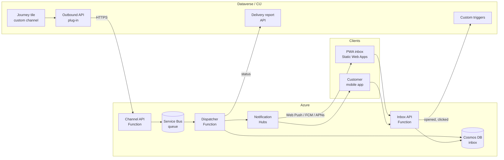
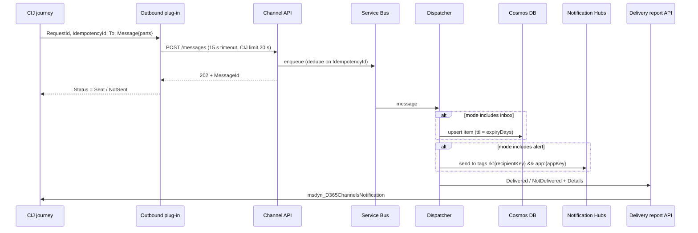
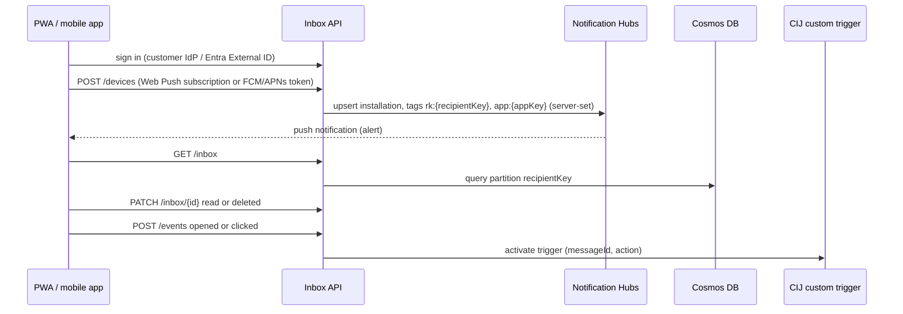

# Architecture

Why each component was chosen: [design-choices.md](design-choices.md). Data details: [data-model.md](data-model.md).

Key Vault, Application Insights, Entra ID and API Management are cross-cutting, so they appear only in the table.

## Components

| Component | Role | Tier (dev → prod) | Source |
|---|---|---|---|
| CIJ custom channel solution | Channel definition, message parts, instance config entity, custom APIs | Managed solution | ([Custom channels in CIJ](https://learn.microsoft.com/dynamics365/customer-insights/journeys/real-time-marketing-extend-outreach-custom-channels), [Channel definition](https://learn.microsoft.com/dynamics365/customer-insights/journeys/real-time-marketing-define-channel-definition), [Message parts](https://learn.microsoft.com/dynamics365/customer-insights/journeys/real-time-marketing-custom-channel-message-parts)) |
| Outbound custom API plug-in | Maps the CIJ payload, POSTs it to the Channel API (15 s timeout), returns `Sent` or `NotSent` | Dataverse sandbox | ([Custom channel custom APIs](https://learn.microsoft.com/dynamics365/customer-insights/journeys/real-time-marketing-custom-channel-custom-api), [Plug-in external call timeout](https://learn.microsoft.com/power-apps/developer/data-platform/best-practices/business-logic/set-timeout-for-external-calls-from-plug-ins)) |
| Delivery-report custom API | Receives Azure callbacks and calls `msdyn_D365ChannelsNotification` | Dataverse | ([Custom channel custom APIs](https://learn.microsoft.com/dynamics365/customer-insights/journeys/real-time-marketing-custom-channel-custom-api)) |
| Custom triggers | Inbox opened, clicked, and dismissed events for journey branching | CIJ | ([Custom triggers](https://learn.microsoft.com/dynamics365/customer-insights/journeys/real-time-marketing-custom-triggers), [Raise triggers](https://learn.microsoft.com/dynamics365/customer-insights/journeys/real-time-marketing-custom-actions)) |
| Channel API (Function, HTTP) | Validates, de-duplicates on `IdempotencyId`, enqueues, returns 202 | Flex Consumption | ([Notification Hubs bindings for Functions](https://learn.microsoft.com/azure/azure-functions/functions-bindings-notification-hubs), [Function with Easy Auth sample](https://learn.microsoft.com/samples/azure-samples/ms-identity-docs-code-dotnet/ms-identity-docs-code-azure-function-csharp/)) |
| Service Bus queue | Buffers fan-out, retries, dead-letter queue | Basic → Standard | ([Service Bus overview](https://learn.microsoft.com/azure/service-bus-messaging/service-bus-messaging-overview)) |
| Dispatcher (Function, queue trigger) | Writes the inbox item, sends the push, reports status | Flex Consumption | ([Notification Hubs bindings for Functions](https://learn.microsoft.com/azure/azure-functions/functions-bindings-notification-hubs)) |
| Cosmos DB for NoSQL | Inbox items, partitioned by `recipientKey`, TTL for expiry | Serverless → provisioned | ([Cosmos DB time to live](https://learn.microsoft.com/azure/cosmos-db/how-to-time-to-live)) |
| Azure Notification Hubs | Tag-based fan-out to Web Push, FCM v1, and APNs. Test send. | Free → Standard (telemetry, PNS feedback) | ([Notification Hubs browser push](https://learn.microsoft.com/azure/notification-hubs/browser-push), [Notification Hubs installations](https://learn.microsoft.com/azure/notification-hubs/notification-hubs-push-notification-registration-management), [Notification Hubs Debug Send](https://learn.microsoft.com/rest/api/notificationhubs/notification-hubs/debug-send), [Notification Hubs pricing](https://azure.microsoft.com/pricing/details/notification-hubs/)) |
| Inbox API (Function, HTTP) | Device registration, list, read, delete, events | Flex Consumption, plus APIM in prod | ([Notification Hubs installations](https://learn.microsoft.com/azure/notification-hubs/notification-hubs-push-notification-registration-management)) |
| Key Vault | ANH, Dataverse, and VAPID secrets through Key Vault references | Standard | ([Key Vault references](https://learn.microsoft.com/azure/app-service/app-service-key-vault-references)) |
| Application Insights | End-to-end tracing (CIJ `RequestId` as correlation ID) | Pay-as-you-go | — |
| Static Web Apps | Hosts the reference PWA inbox (test harness) | Free | ([Static Web Apps](https://learn.microsoft.com/azure/static-web-apps/overview)) |
| Entra ID / External ID | S2S app user for Dataverse callbacks. End-user auth for the Inbox API. | — | ([Entra External ID](https://learn.microsoft.com/entra/external-id/external-identities-overview), [Application users](https://learn.microsoft.com/power-platform/admin/manage-application-users), [Server-to-server authentication](https://learn.microsoft.com/power-apps/developer/data-platform/use-single-tenant-server-server-authentication)) |
| API Management (optional) | Single front door, throttling, keys for mobile apps | Consumption | — |
| azd + Bicep, pac CLI | Replicable provisioning and solution packaging | — | ([azd templates](https://learn.microsoft.com/azure/developer/azure-developer-cli/azd-templates), [azd for Azure Functions](https://learn.microsoft.com/azure/developer/azure-developer-cli/function-app-deployments), [SolutionPackager](https://learn.microsoft.com/power-platform/alm/solution-packager-tool)) |

## Send flow

| Status | When |
|---|---|
| `Sent` | The Channel API returned 202. |
| `NotSent` | Validation failure or 4xx. Not retried. |
| `Delivered` | The inbox write succeeded (inbox modes), or ANH accepted the push (alert-only). |
| `NotDelivered` | No device or inbox target, an ANH error, or a message dead-lettered after retries. `Details` carries the reason. |

Status semantics: see [design choices](design-choices.md#azure-backend).

## Device registration, inbox and interactions

Tags are set by the Inbox API only, from the authenticated user ([Notification Hubs installations](https://learn.microsoft.com/azure/notification-hubs/notification-hubs-push-notification-registration-management)).
