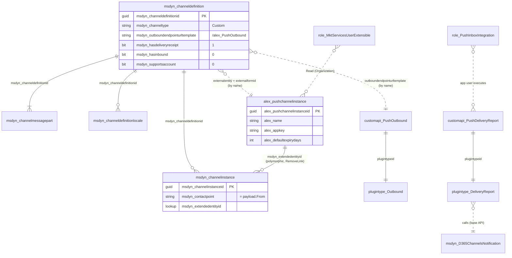
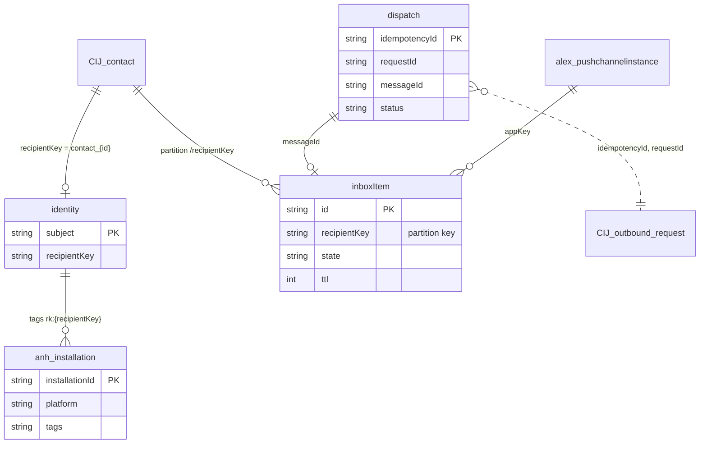

# Data model specification

Dataverse and Azure data model for the Push + Inbox custom channel: tables, columns, user-facing descriptions, relationships, custom APIs, roles, solution layout, Azure schemas and identity mapping. Rationale: [design-choices.md](design-choices.md). Publisher prefix: `alex`. Installation: [installation.md](installation.md). Labels exist in English (1033) and Hebrew (1037).

## 1. How the pieces connect

A custom channel is a set of base CIJ tables plus your own components. Some links are real lookups. Others are **by-name references**: plain strings or GUIDs stored on the channel definition, which aren't enforced by Dataverse ([Channel definition](https://learn.microsoft.com/dynamics365/customer-insights/journeys/real-time-marketing-define-channel-definition)).

| From | To | Link type | Set where | Source |
|---|---|---|---|---|
| `msdyn_channelmessagepart.msdyn_channeldefinitionid` | `msdyn_channeldefinition` | Lookup (N:1) | `customizations.xml` | ([Message parts](https://learn.microsoft.com/dynamics365/customer-insights/journeys/real-time-marketing-custom-channel-message-parts)) |
| `msdyn_channeldefinitionlocale.msdyn_channeldefinitionid` | `msdyn_channeldefinition` | Lookup (N:1), optional | `customizations.xml` | ([Custom channel localization](https://learn.microsoft.com/dynamics365/customer-insights/journeys/real-time-marketing-custom-channel-localization-admin)) |
| `msdyn_channelinstance.msdyn_channeldefinitionid` | `msdyn_channeldefinition` | Lookup (N:1) | Created by CIJ when an admin adds the channel | ([Microsoft sample solution](https://download.microsoft.com/download/44685e3a-8b09-4caa-be78-12bc6867c8d1/SampleCustomChannel.zip)) (sample plug-in query) |
| `msdyn_channelinstance.msdyn_extendedentityid` | **our** `alex_pushchannelinstance` | **Polymorphic lookup.** A hand-authored 1:N relationship, `CascadeDelete=RemoveLink` | `Other/Relationships/alex_pushchannelinstance.xml` | ([Custom channel instance](https://learn.microsoft.com/dynamics365/customer-insights/journeys/real-time-marketing-define-custom-channel-instance), [Multi-table lookups](https://learn.microsoft.com/power-apps/developer/data-platform/webapi/multitable-lookup)) |
| `msdyn_channeldefinition.msdyn_channeldefinitionexternalentity` | `alex_pushchannelinstance` | By name (string) | `customizations.xml` | ([Channel definition](https://learn.microsoft.com/dynamics365/customer-insights/journeys/real-time-marketing-define-channel-definition), [Custom channel instance](https://learn.microsoft.com/dynamics365/customer-insights/journeys/real-time-marketing-define-custom-channel-instance)) |
| `msdyn_channeldefinition.msdyn_channeldefinitionexternalformid` | Main form of `alex_pushchannelinstance` | By ID (GUID) | `customizations.xml` | ([Channel definition](https://learn.microsoft.com/dynamics365/customer-insights/journeys/real-time-marketing-define-channel-definition), [Custom channel instance](https://learn.microsoft.com/dynamics365/customer-insights/journeys/real-time-marketing-define-custom-channel-instance)) |
| `msdyn_channeldefinition.msdyn_outboundendpointurltemplate` | Custom API `alex_PushOutbound` | By name, as `/{uniquename}` | `customizations.xml` | ([Channel definition](https://learn.microsoft.com/dynamics365/customer-insights/journeys/real-time-marketing-define-channel-definition), [Custom channel custom APIs](https://learn.microsoft.com/dynamics365/customer-insights/journeys/real-time-marketing-custom-channel-custom-api)) |
| `customapi.plugintypeid` | Plug-in type in our assembly | Lookup | `customapis/<name>/customapi.xml` | ([Microsoft sample solution](https://download.microsoft.com/download/44685e3a-8b09-4caa-be78-12bc6867c8d1/SampleCustomChannel.zip), [Custom API columns](https://learn.microsoft.com/power-apps/developer/data-platform/customapi-table-columns)) |
| Role **Marketing Services User Extensible Role** (required), plus **Cxp Channel Definitions Services User** where customizable | `alex_pushchannelinstance` | **Read** privilege | Post-import step (see section 4) | ([Channel instance account and Extensible role](https://learn.microsoft.com/dynamics365/customer-insights/journeys/real-time-marketing-define-channel-instance-account), [Custom channel instance](https://learn.microsoft.com/dynamics365/customer-insights/journeys/real-time-marketing-define-custom-channel-instance), [AddPrivilegesRole](https://learn.microsoft.com/power-apps/developer/data-platform/webapi/reference/addprivilegesrole)) |
| Message `Message[<msdyn_name>]` in the outbound payload | `msdyn_channelmessagepart.msdyn_name` | By name (dictionary key) | Runtime | ([Message parts](https://learn.microsoft.com/dynamics365/customer-insights/journeys/real-time-marketing-custom-channel-message-parts), [Custom channel custom APIs](https://learn.microsoft.com/dynamics365/customer-insights/journeys/real-time-marketing-custom-channel-custom-api)) |

**Runtime lookup, as in the sample's plug-in ([Microsoft sample solution](https://download.microsoft.com/download/44685e3a-8b09-4caa-be78-12bc6867c8d1/SampleCustomChannel.zip)):**

1. Query `msdyn_channelinstance` where `msdyn_channeldefinitionid` = `payload.ChannelDefinitionId` and `msdyn_contactpoint` = `payload.From`. The sample notes there's only one instance for each definition and contact point.
2. Read `msdyn_extendedentityid`. This is an `EntityReference` to our config row.
3. Retrieve our config row.

So the **sender ("From") is the channel instance's contact point**. Our extended row holds per-sender configuration.

## 2. Dataverse ER diagram

Solid lines are real lookups or relationships. Dotted lines are by-name references or privileges.



## 3. Dataverse components (exact definitions)

### 3.1 Channel definition (`customizations.xml` → `msdyn_channeldefinitions`) ([Channel definition](https://learn.microsoft.com/dynamics365/customer-insights/journeys/real-time-marketing-define-channel-definition))

| Attribute | Value | Note |
|---|---|---|
| `msdyn_channeldefinitionid` (XML attribute) | **New lowercase GUID** | Never reuse the sample's GUIDs. |
| `msdyn_channeltype` | `Custom` | |
| `msdyn_displayname` / `msdyn_description` | `Push + Inbox` / … | Can be localized through locales ([Custom channel localization](https://learn.microsoft.com/dynamics365/customer-insights/journeys/real-time-marketing-custom-channel-localization-admin)). |
| `msdyn_outboundendpointurltemplate` | `/alex_PushOutbound` | Leading slash plus the custom API unique name ([Channel definition](https://learn.microsoft.com/dynamics365/customer-insights/journeys/real-time-marketing-define-channel-definition), [Microsoft sample solution](https://download.microsoft.com/download/44685e3a-8b09-4caa-be78-12bc6867c8d1/SampleCustomChannel.zip)). |
| `msdyn_hasdeliveryreceipt` | `1` | We report `Delivered` and `NotDelivered` ([Custom channel custom APIs](https://learn.microsoft.com/dynamics365/customer-insights/journeys/real-time-marketing-custom-channel-custom-api)). |
| `msdyn_hasinbound` | `0` | Inbound is documented for SMS only ([Custom channel custom APIs](https://learn.microsoft.com/dynamics365/customer-insights/journeys/real-time-marketing-custom-channel-custom-api)). |
| `msdyn_supportsaccount` | `0` | Docs: "For SMS, it must be true; otherwise, false" ([Channel definition](https://learn.microsoft.com/dynamics365/customer-insights/journeys/real-time-marketing-define-channel-definition)). Account entities are "Not supported" for Custom ([Custom channels in CIJ](https://learn.microsoft.com/dynamics365/customer-insights/journeys/real-time-marketing-extend-outreach-custom-channels)). The sample sets `1` and points to an account entity it doesn't ship, so don't copy that ([Microsoft sample solution](https://download.microsoft.com/download/44685e3a-8b09-4caa-be78-12bc6867c8d1/SampleCustomChannel.zip)). |
| `msdyn_channeldefinitionexternalentity` | `alex_pushchannelinstance` | |
| `msdyn_channeldefinitionexternalformid` | Main form GUID of the entity above (lowercase) | Rendered in the CIJ channel setup wizard ([Custom channel instance](https://learn.microsoft.com/dynamics365/customer-insights/journeys/real-time-marketing-define-custom-channel-instance)). |
| `msdyn_messageformid` | *(omit)* | Use the built-in generic editor, as the docs recommend ([Message editor](https://learn.microsoft.com/dynamics365/customer-insights/journeys/real-time-marketing-custom-channel-message-editor)). |
| `msdyn_specialconsentrequired`, `msdyn_supportsattachment`, `msdyn_supportsbinary` | `0` | As in the sample and docs examples ([Channel definition](https://learn.microsoft.com/dynamics365/customer-insights/journeys/real-time-marketing-define-channel-definition), [Microsoft sample solution](https://download.microsoft.com/download/44685e3a-8b09-4caa-be78-12bc6867c8d1/SampleCustomChannel.zip)). |
| `msdyn_outboundbatchendpointurltemplate` | *(omit)* | Undocumented, so not used. Single-message API only ([Custom channel custom APIs](https://learn.microsoft.com/dynamics365/customer-insights/journeys/real-time-marketing-custom-channel-custom-api)). |

### 3.2 Message parts (`customizations.xml` → `msdyn_channelmessageparts`) ([Message parts](https://learn.microsoft.com/dynamics365/customer-insights/journeys/real-time-marketing-custom-channel-message-parts))

Each part has its own lowercase GUID, `msdyn_channeldefinitionid` set to the definition above, and `msdyn_name` used as the key of `payload.Message` ([Message parts](https://learn.microsoft.com/dynamics365/customer-insights/journeys/real-time-marketing-custom-channel-message-parts), [Custom channel custom APIs](https://learn.microsoft.com/dynamics365/customer-insights/journeys/real-time-marketing-custom-channel-custom-api)). `msdyn_order`: a larger number puts the part higher in the editor ([Message parts](https://learn.microsoft.com/dynamics365/customer-insights/journeys/real-time-marketing-custom-channel-message-parts)).

| `msdyn_name` | Type (`msdyn_type`) | Required | Max length | Order | Notes |
|---|---|---|---|---|---|
| `title` | plaintext `192350000` | Yes | 65 | 70 | Push title and inbox subject. |
| `body` | plaintext `192350000` | Yes | 1000 | 60 | Clients truncate the alert body. The inbox shows it in full. |
| `imageId` | image `192350004` | No | – | 50 | The marketer picks an image from the CIJ asset library. The part holds the `msdyncrm_file` ID ([Message parts](https://learn.microsoft.com/dynamics365/customer-insights/journeys/real-time-marketing-custom-channel-message-parts)). The outbound plug-in resolves it to the asset's public URL; see [Image resolution](#image-resolution). |
| `actionUrl` | plaintext `192350000` | No | 1000 | 40 | Deep link or URL. CIJ shortens links in custom channel messages, and they expire after 6 months ([Create custom channels](https://learn.microsoft.com/dynamics365/customer-insights/journeys/real-time-marketing-create-custom-channels)).  |
| `deliveryMode` | options `192350008` | Yes | – | 30 | `msdyn_options`: `[{"label":"Alert + Inbox","value":1},{"label":"Inbox only","value":2},{"label":"Alert only","value":3}]` ([Message parts](https://learn.microsoft.com/dynamics365/customer-insights/journeys/real-time-marketing-custom-channel-message-parts)). |
| `inboxExpiryDays` | number `192350006` | No | – | 20 | Capped at 180 by the Channel API. The default comes from channel instance config. |
| `replaceKey` | plaintext `192350000` | No | 100 | 10 | The same key replaces the recipient's earlier inbox item. |

#### Image resolution

The `imageId` part uses the CIJ asset library, so marketers don't type URLs.

- **Stored value.** The message (`msdynmkt_customchannelmessage.msdynmkt_messageparts`, JSON keyed by `msdyn_name`) stores the bare `msdyncrm_file` ID of the chosen asset, or `null` when none is chosen. Learn: "The message part is an image ID of the msdyncrm_file entity" ([Message parts](https://learn.microsoft.com/dynamics365/customer-insights/journeys/real-time-marketing-custom-channel-message-parts)).
- **Public URL.** `msdyncrm_file.msdyncrm_blobcdnuri`, for example `https://<geo CDN host>/<organization ID>/digitalassets/images/<file ID>?ts=<version>`. It is anonymous by design: "Assets must be available publicly on the internet" ([Asset library](https://learn.microsoft.com/dynamics365/customer-insights/journeys/upload-images-files)). It differs per environment, so it is always read from the column, never built. The other URL columns (`msdyncrm_bloburi`, `msdyncrm_mainimage_url`) are Dataverse-relative and require sign-in.
- **Where it is resolved.** The `alex_PushOutbound` plug-in, at send time:
  1. Empty value: no image.
  2. An absolute `https` URL: passed through unchanged.
  3. A GUID: `Retrieve("msdyncrm_file", id, msdyncrm_blobcdnuri, msdyncrm_contenttype)`. If the asset has an `https` URL and an `image/*` content type, that URL is used.
  4. Anything else, or a missing asset: the message is sent **without** an image, and the plug-in writes a trace with the asset ID. The send doesn't fail, because the image is optional.
- **Contract with Azure.** The plug-in still forwards the CIJ payload unchanged, and sends the resolved URL in the `x-push-image-url` header. The Channel API uses that header, or `Message.imageId` when it is already an `https` URL, and stores it as `imageUrl` on the inbox item.
- **Privileges.** The plug-in runs as the SYSTEM user (`CreateOrganizationService(null)`), so no role change is needed. The Azure managed identity needs no Dataverse read access.
- **Upgrade from the plain-text `imageUrl` part.** Importing the new solution over an earlier version renames the part and changes its type, but keeps `msdyn_maxlength` at 1000. Clear it on the `msdyn_channelmessagepart` row if you want the definition to match a fresh install. Messages saved with the old plain-text part keep an `imageUrl` key that is no longer read; select the image again.

### 3.3 Extended channel instance entity `alex_pushchannelinstance` ([Custom channel instance](https://learn.microsoft.com/dynamics365/customer-insights/journeys/real-time-marketing-define-custom-channel-instance))

- **Naming:** the docs require a "lowerCamelCase" logical name ([Custom channel instance](https://learn.microsoft.com/dynamics365/customer-insights/journeys/real-time-marketing-define-custom-channel-instance)). Dataverse logical names are lowercase, so we follow the sample exactly: the prefix plus a single lowercase word, with schema name equal to logical name (`cr65f_samplechannelinstance` ([Microsoft sample solution](https://download.microsoft.com/download/44685e3a-8b09-4caa-be78-12bc6867c8d1/SampleCustomChannel.zip))).
- **Ownership:** User-owned, as in the sample ([Microsoft sample solution](https://download.microsoft.com/download/44685e3a-8b09-4caa-be78-12bc6867c8d1/SampleCustomChannel.zip)). CIJ's service roles get Read at **Organization** depth.
- **Columns:** credentials are deliberately absent.

| Column | Type | Required | Purpose |
|---|---|---|---|
| `alex_name` | Text (100), primary name | Yes | Same pattern as the sample. CIJ controls also show the name ([Custom channel instance](https://learn.microsoft.com/dynamics365/customer-insights/journeys/real-time-marketing-define-custom-channel-instance)). |
| `alex_appkey` | Text (100) | Yes | Logical app or tenant key in Azure. Selects the Notification Hub and inbox namespace. Tag-safe characters only ([Notification Hubs tag expressions](https://learn.microsoft.com/azure/notification-hubs/notification-hubs-tags-segment-push-message)). |
| `alex_defaultexpirydays` | Whole number (1–180) | No | Default inbox expiry when the message part is empty. Defaults to 30 on create: the form OnLoad script `alex_/scripts/pushchannelinstance.js` sets it, and the PreOperation Create plug-in `DefaultExpiryPlugin` sets it for API-created rows. |
| `alex_channelapikey` | Text (200), **column security** on | Test only | Function key for test environments. Production uses Power Platform managed identity instead ([Power Platform managed identity](https://learn.microsoft.com/power-platform/admin/set-up-managed-identity), [Column-level security](https://learn.microsoft.com/power-platform/admin/field-level-security)). |

- **Form:** one **main** form with `alex_appkey` and `alex_defaultexpirydays`. Its lowercase GUID goes into `msdyn_channeldefinitionexternalformid`. Name and description fields aren't needed on the form ([Custom channel instance](https://learn.microsoft.com/dynamics365/customer-insights/journeys/real-time-marketing-define-custom-channel-instance)).
- **Channel API base URL:** stored in environment variable `alex_ChannelApiBaseUrl` (type String), with its value set per environment at import ([Environment variables](https://learn.microsoft.com/power-apps/maker/data-platform/environmentvariables)).
  - Don't use a *secret*-type environment variable from a plug-in. The documented retrieval is the `RetrieveEnvironmentVariableSecretValue` action in flows ([Key Vault secret environment variables](https://learn.microsoft.com/power-apps/maker/data-platform/environmentvariables-azure-key-vault-secrets)).

### 3.4 The polymorphic relationship (hand-authored) ([Custom channel instance](https://learn.microsoft.com/dynamics365/customer-insights/journeys/real-time-marketing-define-custom-channel-instance), [Microsoft sample solution](https://download.microsoft.com/download/44685e3a-8b09-4caa-be78-12bc6867c8d1/SampleCustomChannel.zip))

`Other/Relationships/alex_pushchannelinstance.xml`:

```xml
<?xml version="1.0" encoding="utf-8"?>
<EntityRelationships xmlns:xsi="http://www.w3.org/2001/XMLSchema-instance">
  <EntityRelationship Name="msdyn_ChannelInstance_extendedentityid_alex_pushchannelinstance">
    <EntityRelationshipType>OneToMany</EntityRelationshipType>
    <IsCustomizable>0</IsCustomizable>
    <IntroducedVersion>1.0.0.0</IntroducedVersion>
    <IsHierarchical>0</IsHierarchical>
    <ReferencingEntityName>msdyn_ChannelInstance</ReferencingEntityName>
    <ReferencedEntityName>alex_pushchannelinstance</ReferencedEntityName>
    <CascadeAssign>NoCascade</CascadeAssign>
    <CascadeDelete>RemoveLink</CascadeDelete>
    <CascadeReparent>NoCascade</CascadeReparent>
    <CascadeShare>NoCascade</CascadeShare>
    <CascadeUnshare>NoCascade</CascadeUnshare>
    <CascadeRollupView>NoCascade</CascadeRollupView>
    <IsValidForAdvancedFind>1</IsValidForAdvancedFind>
    <ReferencingAttributeName>msdyn_extendedentityId</ReferencingAttributeName>
    <RelationshipDescription>
      <Descriptions>
        <Description description="" languagecode="1033" />
      </Descriptions>
    </RelationshipDescription>
    <EntityRelationshipRoles>
      <EntityRelationshipRole>
        <NavPaneDisplayOption>UseCollectionName</NavPaneDisplayOption>
        <NavPaneArea>Details</NavPaneArea>
        <NavPaneOrder>10000</NavPaneOrder>
        <NavigationPropertyName>msdyn_extendedentityid_alex_pushchannelinstance</NavigationPropertyName>
        <RelationshipRoleType>1</RelationshipRoleType>
      </EntityRelationshipRole>
      <EntityRelationshipRole>
        <NavigationPropertyName>msdyn_ChannelInstance_extendedentityid_alex_pushchannelinstance</NavigationPropertyName>
        <RelationshipRoleType>0</RelationshipRoleType>
      </EntityRelationshipRole>
    </EntityRelationshipRoles>
  </EntityRelationship>
</EntityRelationships>
```

Also required:

- In `Other/Relationships.xml`, add `<EntityRelationship Name="msdyn_ChannelInstance_extendedentityid_alex_pushchannelinstance" />` ([Custom channel instance](https://learn.microsoft.com/dynamics365/customer-insights/journeys/real-time-marketing-define-custom-channel-instance)).
- Add `Entities/msdyn_ChannelInstance/Entity.xml` as a **shell**. It declares only the existing `msdyn_extendedentityId` lookup attribute (`LookupStyle=polymorphic`, `unmodified="1"`).
- In `Solution.xml`, add `msdyn_channelinstance` as a root component with `behavior="1"`. This is how the sample ships it ([Microsoft sample solution](https://download.microsoft.com/download/44685e3a-8b09-4caa-be78-12bc6867c8d1/SampleCustomChannel.zip)).
- Notes on names:
  - The case matters: `msdyn_ChannelInstance` and `msdyn_extendedentityId` are **schema names**, while navigation property names use lowercase `extendedentityid`.
  - These are copied verbatim from the docs and sample. Don't "normalize" them ([Custom channel instance](https://learn.microsoft.com/dynamics365/customer-insights/journeys/real-time-marketing-define-custom-channel-instance), [Microsoft sample solution](https://download.microsoft.com/download/44685e3a-8b09-4caa-be78-12bc6867c8d1/SampleCustomChannel.zip)).

### 3.5 Custom APIs ([Custom channel custom APIs](https://learn.microsoft.com/dynamics365/customer-insights/journeys/real-time-marketing-custom-channel-custom-api), [Microsoft sample solution](https://download.microsoft.com/download/44685e3a-8b09-4caa-be78-12bc6867c8d1/SampleCustomChannel.zip), [Custom API columns](https://learn.microsoft.com/power-apps/developer/data-platform/customapi-table-columns))

Both are unbound actions:

- `bindingtype=0` (Global), `isfunction=0`, `allowedcustomprocessingsteptype=0` (None), `isprivate=0`, `iscustomizable=0`.
- The implementing plug-in is linked through `plugintypeid` on the custom API itself. **No SDK message processing step is registered**, which is how the sample does it.

| Unique name | Request parameter | Response property | Plug-in behavior |
|---|---|---|---|
| `alex_PushOutbound` | `payload` (String, type 10, required) | `response` (String, type 10) | Deserializes the outbound contract ([Custom channel custom APIs](https://learn.microsoft.com/dynamics365/customer-insights/journeys/real-time-marketing-custom-channel-custom-api)) and resolves the channel instance config (section 1). It POSTs to `{alex_ChannelApiBaseUrl}/messages` with a timeout under 20 s total ([Custom channel custom APIs](https://learn.microsoft.com/dynamics365/customer-insights/journeys/real-time-marketing-custom-channel-custom-api), [Plug-in external call timeout](https://learn.microsoft.com/power-apps/developer/data-platform/best-practices/business-logic/set-timeout-for-external-calls-from-plug-ins)). It returns `Sent` with a `MessageId` on 202, or `NotSent` with `Details` on a non-retriable 4xx. |
| `alex_PushDeliveryReport` | `payload` (String, type 10, required) | `response` (String, type 10) | Called by the Azure Dispatcher, running as an application user ([Application users](https://learn.microsoft.com/power-platform/admin/manage-application-users)). It builds the notification contract and executes `msdyn_D365ChannelsNotification` with `notificationPayLoad` ([Custom channel custom APIs](https://learn.microsoft.com/dynamics365/customer-insights/journeys/real-time-marketing-custom-channel-custom-api), [Microsoft sample solution](https://download.microsoft.com/download/44685e3a-8b09-4caa-be78-12bc6867c8d1/SampleCustomChannel.zip)). |

**Outbound payload fields we use ([Custom channel custom APIs](https://learn.microsoft.com/dynamics365/customer-insights/journeys/real-time-marketing-custom-channel-custom-api)):**

| Field | Use |
|---|---|
| `ChannelDefinitionId`, `From` | Instance lookup |
| `RequestId` | Correlation |
| `IdempotencyId` | De-duplication across CIJ retries |
| `To` | Fallback recipient |
| `Message{}` | The message parts |
| `MarketingAppContext.UserId`, `UserEntityType` | The recipient's CIJ record (null for test sends) |
| `MarketingAppContext.CustomerJourneyId` | Analytics and debugging |
| `MarketingAppContext.IsTestSend` | Test handling |

### 3.6 Security roles

| Role | Shipped how | Privileges |
|---|---|---|
| **Marketing Services User Extensible Role** (Microsoft-owned, customizable) | **Not** put in our solution. A post-import script calls `AddPrivilegesRole` with `prvReadalex_pushchannelinstance` at Global (Organization) depth ([AddPrivilegesRole](https://learn.microsoft.com/power-apps/developer/data-platform/webapi/reference/addprivilegesrole)). The CIJ application user holds this role. | Read on `alex_pushchannelinstance` (**required** ([Channel instance account and Extensible role](https://learn.microsoft.com/dynamics365/customer-insights/journeys/real-time-marketing-define-channel-instance-account))) |
| **Cxp Channel Definitions Services User** (Microsoft-owned) | Same script, best effort. Skipped with a warning where the role is locked (`0x8004023b`) ([Custom channel instance](https://learn.microsoft.com/dynamics365/customer-insights/journeys/real-time-marketing-define-custom-channel-instance), [Managed properties](https://learn.microsoft.com/power-platform/alm/managed-properties-alm)). | Read on `alex_pushchannelinstance` |
| `Push Inbox Channel Integration` (ours, planned) | In the solution | Assigned to the Azure application user ([Application users](https://learn.microsoft.com/power-platform/admin/manage-application-users)). Read on `alex_pushchannelinstance`, plus the minimum base privileges an app user needs to execute the delivery-report API. |
| `Push Inbox Channel Admin` (ours, planned) | In the solution | Create, read, write, and delete on `alex_pushchannelinstance` for CIJ admins configuring the channel. |

### 3.7 Field descriptions (written into solution metadata)

**Rule:** every table, column, environment variable and message part we ship must have a non-empty **Description** in the solution metadata. The text below is that description, written for a marketer or CIJ admin rather than a developer. Where it goes:

- Table and column descriptions go in `Entities/<table>/Entity.xml` (`<Descriptions><Description description="…" languagecode="1033"/>`). Dataverse shows them as the field's help text ([Column descriptions](https://learn.microsoft.com/power-apps/maker/data-platform/create-edit-field-portal)). The sample leaves these empty ([Microsoft sample solution](https://download.microsoft.com/download/44685e3a-8b09-4caa-be78-12bc6867c8d1/SampleCustomChannel.zip)), so don't copy it.
- Message part `msdyn_displayname` and `msdyn_description` go in `Customizations.xml` ([Message parts](https://learn.microsoft.com/dynamics365/customer-insights/journeys/real-time-marketing-custom-channel-message-parts)). They can be translated through the channel definition locale keys `ChannelMessagePart.<part>.DisplayName` and `.Description` ([Custom channel localization](https://learn.microsoft.com/dynamics365/customer-insights/journeys/real-time-marketing-custom-channel-localization-admin)).
- The channel definition's `msdyn_description` and the environment variable's description go in their own XML files ([Channel definition](https://learn.microsoft.com/dynamics365/customer-insights/journeys/real-time-marketing-define-channel-definition), [Environment variables](https://learn.microsoft.com/power-apps/maker/data-platform/environmentvariables)).
- `msdyn_description` of a message part is limited to **100 characters** (import fails otherwise), so part descriptions are short.
- Every label and description exists in **1033 (English) and 1037 (Hebrew)**. Table, column, form, view and environment variable labels come through the translation file ([Translate table and column text](https://learn.microsoft.com/power-apps/maker/data-platform/export-customized-entity-field-text-translation)); channel definition and message part labels come through `msdyn_channeldefinitionlocale` ([Custom channel localization](https://learn.microsoft.com/dynamics365/customer-insights/journeys/real-time-marketing-custom-channel-localization-admin)). Workflow: [localization.md](localization.md).
- The solution check (`tests/solution/check_solution.py`, run by the pre-commit hook) blocks the commit if any label is empty, if a 1037 label has no Hebrew letters, or if a 1033 label has Hebrew letters.

**Table `alex_pushchannelinstance`**: display name *Push sender* / *שולח פוש*, plural *Push senders* / *שולחי פוש*. Description: "Connection settings for sending push notifications and app inbox messages from Customer Insights - Journeys." / "הגדרות חיבור לשליחת התראות פוש והודעות לתיבת ההודעות באפליקציה מתוך Customer Insights - Journeys."

All 21 columns, including the system columns that come with the table (generated from `Entity.xml`):

| Display name (1033) | Display name (1037) | Logical name | Type | Description (1033) | Description (1037) |
|---|---|---|---|---|---|
| App key | מפתח אפליקציה | `alex_appkey` | nvarchar | Identifies the mobile or web app that receives these messages. Your app team provides it. Use only letters, numbers and hyphens. | מזהה את אפליקציית המובייל או אפליקציית האינטרנט שמקבלת את ההודעות. צוות האפליקציה מספק אותו. יש להשתמש באותיות לועזיות, ספרות ומקפים בלבד. |
| Channel API key | מפתח API של הערוץ | `alex_channelapikey` | nvarchar | Secret key used to connect to the Azure messaging service. Only administrators can see it. For test environments only; production connects without a stored key. | מפתח סודי לחיבור לשירות ההודעות ב-Azure. רק מנהלי מערכת יכולים לראות אותו. לסביבות בדיקה בלבד; בסביבת הייצור החיבור מתבצע ללא מפתח שמור. |
| Default inbox expiry (days) | תוקף ברירת מחדל בתיבת ההודעות (ימים) | `alex_defaultexpirydays` | int | How many days a message stays in the app inbox if the message doesn't set its own value. 1 to 180; default 30. | מספר הימים שהודעה נשארת בתיבת ההודעות באפליקציה, כאשר ההודעה עצמה לא קובעת ערך. בין 1 ל-180; ברירת מחדל 30. |
| Name | שם | `alex_name` | nvarchar | A friendly name for this push sender. Marketers see it when they choose a channel in a journey. | שם ידידותי לשולח הפוש. אנשי השיווק רואים אותו כשהם בוחרים ערוץ במסע לקוח. |
| Push sender ID | מזהה שולח פוש | `alex_pushchannelinstanceid` | primarykey | System-generated unique ID of this push sender. You don't need to enter it. | מזהה ייחודי של שולח הפוש שהמערכת יוצרת. אין צורך להזין אותו. |
| Created By | נוצר על-ידי | `createdby` | lookup | The user who created this push sender. | המשתמש שיצר את שולח הפוש. |
| Created On | תאריך יצירה | `createdon` | datetime | Date and time this push sender was created. | התאריך והשעה שבהם נוצר שולח הפוש. |
| Created By (Delegate) | נוצר על-ידי (נציג) | `createdonbehalfby` | lookup | The user who created this push sender on behalf of another user. | המשתמש שיצר את שולח הפוש בשם משתמש אחר. |
| Import Sequence Number | מספר רצף ייבוא | `importsequencenumber` | int | Set automatically when the record is created by a data import. Used to track the import. | נקבע אוטומטית כאשר הרשומה נוצרת בייבוא נתונים. משמש למעקב אחר הייבוא. |
| Modified By | שונה על-ידי | `modifiedby` | lookup | The user who last changed this push sender. | המשתמש ששינה לאחרונה את שולח הפוש. |
| Modified On | תאריך שינוי | `modifiedon` | datetime | Date and time this push sender was last changed. | התאריך והשעה שבהם שולח הפוש שונה לאחרונה. |
| Modified By (Delegate) | שונה על-ידי (נציג) | `modifiedonbehalfby` | lookup | The user who last changed this push sender on behalf of another user. | המשתמש ששינה לאחרונה את שולח הפוש בשם משתמש אחר. |
| Record Created On | תאריך יצירת הרשומה המקורי | `overriddencreatedon` | datetime | Original creation date when the record was migrated from another system. | תאריך היצירה המקורי, כאשר הרשומה הועברה ממערכת אחרת. |
| Owner | בעלים | `ownerid` | owner | The user or team that owns this push sender and is responsible for it. | המשתמש או הצוות שבבעלותם שולח הפוש והאחראים עליו. |
| Owning Business Unit | יחידה עסקית בעלים | `owningbusinessunit` | lookup | The business unit of the owner. Set automatically from the owner. | היחידה העסקית של הבעלים. נקבעת אוטומטית לפי הבעלים. |
| Owning Team | צוות בעלים | `owningteam` | lookup | Unique identifier for the team that owns the record. | המזהה הייחודי של הצוות שבבעלותו הרשומה. |
| Owning User | משתמש בעלים | `owninguser` | lookup | Unique identifier for the user that owns the record. | המזהה הייחודי של המשתמש שבבעלותו הרשומה. |
| Status | מצב | `statecode` | state | Status of the Push sender | המצב של שולח הפוש |
| Status Reason | סיבת המצב | `statuscode` | status | Reason for the status of the Push sender | הסיבה למצב של שולח הפוש |
| Time Zone Rule Version Number | מספר גרסה של כלל אזור הזמן | `timezoneruleversionnumber` | int | For internal use only. | לשימוש פנימי בלבד. |
| UTC Conversion Time Zone Code | קוד אזור זמן להמרת UTC | `utcconversiontimezonecode` | int | Time zone code that was in use when the record was created. | קוד אזור הזמן שהיה בשימוש בעת יצירת הרשומה. |

**Environment variable**

| Display name | Schema name | Type | Description (Dataverse metadata) |
|---|---|---|---|
| Push channel service address / כתובת שירות ערוץ הפוש | `alex_ChannelApiBaseUrl` | Text | Web address of the Azure push and inbox service for this environment, for example https://contoso-push.azurewebsites.net. Set it once when the solution is installed. / כתובת האינטרנט של שירות הפוש ותיבת ההודעות ב-Azure עבור סביבה זו, לדוגמה https://contoso-push.azurewebsites.net. יש להגדיר אותה פעם אחת בעת התקנת הפתרון. |

**Channel definition** (`msdyn_displayname` / `msdyn_description`): *Push + Inbox* / "Send push notifications that are also saved to the customer's in-app inbox." Hebrew: *Push ותיבת הודעות* / "שליחת התראות Push שנשמרות גם בתיבת ההודעות של הלקוח באפליקציה."

**Message parts** (what marketers see in the message editor)

| Name (`msdyn_name`) | Type | Display name 1033 / 1037 | Description 1033 (`msdyn_description`, ≤100 chars) | Description 1037 (locale key) |
|---|---|---|---|---|
| `title` | Plain text, required, 65 | Title / כותרת | Headline on the notification and the inbox subject. Up to 65 characters. | הכותרת בהתראה ונושא ההודעה בתיבת ההודעות. עד 65 תווים. |
| `body` | Plain text, required, 1000 | Message / הודעה | Main message text. The notification may shorten it; the inbox shows it in full. | טקסט ההודעה. ההתראה עשויה לקצר אותו; תיבת ההודעות מציגה אותו במלואו. |
| `imageId` | Image | Image / תמונה | Optional image from the asset library, shown with the message. | תמונה אופציונלית מספריית הנכסים, שמוצגת עם ההודעה. |
| `actionUrl` | Plain text, 1000 | Tap action link / קישור לפעולה בהקשה | Where the customer goes on tap: a web page or a screen in the app. | לאן הלקוח מגיע בהקשה: דף אינטרנט או מסך באפליקציה. |
| `deliveryMode` | Options, required | Delivery mode / אופן מסירה | Alert + Inbox, Inbox only (silent), or Alert only (not saved to the inbox). | Alert + Inbox, ‏Inbox only (שקטה) או Alert only (לא נשמרת בתיבת ההודעות). |
| `inboxExpiryDays` | Number | Inbox expiry (days) / תפוגה בתיבת ההודעות (ימים) | Days the message stays in the inbox (max 180). Leave empty for the channel default. | מספר הימים שההודעה נשארת בתיבת ההודעות (עד 180). ריק = ברירת המחדל של הערוץ. |
| `replaceKey` | Plain text, 100 | Replace key / מפתח החלפה | Optional. A newer message with the same key replaces the earlier one. | אופציונלי. הודעה חדשה עם אותו מפתח מחליפה את ההודעה הקודמת. |

## 4. Solution folder layout (unpacked, `pac solution unpack` format) ([SolutionPackager](https://learn.microsoft.com/power-platform/alm/solution-packager-tool), [Microsoft sample solution](https://download.microsoft.com/download/44685e3a-8b09-4caa-be78-12bc6867c8d1/SampleCustomChannel.zip))

```text
solution/AlexPushInboxChannel/
  Other/
    Solution.xml                      root components: msdyn_channelinstance (behavior=1), alex_* entities, plug-in assembly, env var
    Customizations.xml                msdyn_channeldefinitions, msdyn_channelmessageparts, msdyn_channeldefinitionlocales (lowercase GUIDs)
    Relationships.xml                 + <EntityRelationship Name="msdyn_ChannelInstance_extendedentityid_alex_pushchannelinstance" />
    Relationships/
      alex_pushchannelinstance.xml   HAND-AUTHORED polymorphic relationship (section 3.4)
      BusinessUnit.xml Owner.xml SystemUser.xml Team.xml   generated by pac
  Entities/
    msdyn_ChannelInstance/Entity.xml  shell: msdyn_extendedentityId attribute only
    alex_pushchannelinstance/
      Entity.xml
      FormXml/main/{form-guid}.xml    GUID referenced by msdyn_channeldefinitionexternalformid
      SavedQueries/...
  customapis/
    alex_PushOutbound/customapi.xml
      customapirequestparameters/payload/customapirequestparameter.xml
      customapiresponseproperties/response/customapiresponseproperty.xml
    alex_PushDeliveryReport/...      same shape
  PluginAssemblies/AlexPushInboxPlugins-{guid}/AlexPushInboxPlugins.dll(.data.xml)
  Roles/Push Inbox Channel Admin.xml, Push Inbox Channel Integration.xml   (planned)
  environmentvariabledefinitions/alex_ChannelApiBaseUrl/environmentvariabledefinition.xml
deploy/
  post-import.sh                      AddPrivilegesRole on CIJ's service roles (idempotent) ([AddPrivilegesRole](https://learn.microsoft.com/power-apps/developer/data-platform/webapi/reference/addprivilegesrole))
tools/l10n/                           translation export/fill/import/verify (localization.md)
tests/solution/
  check_solution.py                   CI: relationship file + Relationships.xml line + shell entity + lowercase GUIDs + 1033/1037 labels
```

**ALM rule:** the unpacked folder in Git is the source of truth. Always build with `pac solution pack`, run the structure tests first, and never rely on re-exporting the relationship from an environment.

## 5. Azure data model

### 5.1 Cosmos DB for NoSQL, database `pushinbox` (serverless for development)

| Container | Partition key | `id` | TTL | Purpose |
|---|---|---|---|---|
| `inboxItems` | `/recipientKey` | `replaceKey ? hash(appKey + replaceKey) : messageId` | Container `defaultTtl = -1`, so items don't expire unless they set `ttl`. Each item sets `ttl = expiryDays × 86400` ([Cosmos DB time to live](https://learn.microsoft.com/azure/cosmos-db/how-to-time-to-live)). | The recipient's inbox. All reads are single-partition ([Cosmos DB partitioning](https://learn.microsoft.com/azure/cosmos-db/partitioning-overview)). Using a deterministic `id` makes "replace" a plain upsert. |
| `dispatches` | `/idempotencyId` | `idempotencyId` | 30 days | Idempotency: a create conflict means the request is a duplicate, so the API returns the stored result. Also maps `requestId` and `messageId` for the delivery report. This replaces the sample's `cr65f_requestmessagemapping` Dataverse table ([Microsoft sample solution](https://download.microsoft.com/download/44685e3a-8b09-4caa-be78-12bc6867c8d1/SampleCustomChannel.zip)), so there are no per-message Dataverse writes ([Dataverse API limits](https://learn.microsoft.com/power-apps/developer/data-platform/api-limits)). |
| `identities` | `/subject` | `subject` | None | Maps the app user's identity (`iss` + `sub` from the app's IdP token) to `recipientKey`. Filled at device registration (section 6). |

`inboxItems` schema:

```json
{
  "id": "string",
  "recipientKey": "contact_6f9619ff-8b86-d011-b42d-00c04fc964ff",
  "appKey": "contoso-retail",
  "messageId": "guid (returned to CIJ as MessageId)",
  "requestId": "string", "idempotencyId": "string",
  "channelDefinitionId": "guid", "customerJourneyId": "string|null",
  "title": "string", "body": "string", "imageUrl": "string|null", "actionUrl": "string|null",
  "deliveryMode": "alertInbox|inbox|alert",
  "replaceKey": "string|null",
  "state": "unread|read|deleted",
  "createdAt": "ISO-8601", "readAt": "ISO-8601|null",
  "ttl": 2592000
}
```

Alert-only messages don't create an `inboxItems` document. Only the `dispatches` record is kept.

### 5.2 Azure Notification Hubs installations ([Notification Hubs installations](https://learn.microsoft.com/azure/notification-hubs/notification-hubs-push-notification-registration-management), [Notification Hubs tag expressions](https://learn.microsoft.com/azure/notification-hubs/notification-hubs-tags-segment-push-message))

| Field | Value |
|---|---|
| `installationId` | A stable ID generated by the client per browser or device |
| `platform` | `browser` (PWA, Web Push/VAPID ([Notification Hubs browser push](https://learn.microsoft.com/azure/notification-hubs/browser-push))), `fcmv1`, or `apns` |
| `pushChannel` | Browser: `endpoint`, `p256dh`, and `auth`. Mobile: the platform token. |
| `tags` | **Set by the Inbox API only, never by the client:** `rk:{recipientKey}` and `app:{appKey}`. Tags are at most 120 characters, using alphanumeric characters and `_ @ # . : -`, with at most 60 per registration ([Notification Hubs tag expressions](https://learn.microsoft.com/azure/notification-hubs/notification-hubs-tags-segment-push-message)). |

The send targets the tag expression `rk:{recipientKey} && app:{appKey}`. AND-only expressions can reference up to 10 tags ([Notification Hubs tag expressions](https://learn.microsoft.com/azure/notification-hubs/notification-hubs-tags-segment-push-message)).

### 5.3 Azure ER diagram



## 6. Recipient identity mapping (CIJ ↔ Azure ↔ device)

1. **At send:** the Channel API computes `recipientKey = lower({MarketingAppContext.UserEntityType}_{MarketingAppContext.UserId})`, for example `contact_<guid>`. `UserId` is the ID of the record receiving the message ([Custom channel custom APIs](https://learn.microsoft.com/dynamics365/customer-insights/journeys/real-time-marketing-custom-channel-custom-api)). 
2. **Test sends:** `MarketingAppContext` values are null for test sends ([Custom channel custom APIs](https://learn.microsoft.com/dynamics365/customer-insights/journeys/real-time-marketing-custom-channel-custom-api)). The Channel API then uses `To`, which must already be mapped in `identities` (the test contact registered from the PWA). If it isn't mapped, it returns `NotSent` with the reason `UnknownRecipient`.
3. **At device registration:**
   - The app user calls `POST /devices` with their IdP token.
   - The Inbox API validates the token. It resolves `recipientKey` by finding the CIJ contact through a configured **verified** claim, for example a verified email or a customer ID. The match goes against a Dataverse alternate key ([Alternate keys](https://learn.microsoft.com/power-apps/developer/data-platform/define-alternate-keys-entity)), such as a customer-number column. It uses one Dataverse read per first registration, then caches in `identities` ([Dataverse API limits](https://learn.microsoft.com/power-apps/developer/data-platform/api-limits)).
   - It upserts the ANH installation with server-set tags (section 5.2).
4. **Leads:** the same flow works with `UserEntityType = lead`. Contact-to-lead merges are out of scope for v1.

## 7. Build rules

1. Hand-author the relationship file and its `Relationships.xml` line. Never use the XrmToolBox Polymorphic Lookup Creator ([Custom channel instance](https://learn.microsoft.com/dynamics365/customer-insights/journeys/real-time-marketing-define-custom-channel-instance)).
2. Ship the `msdyn_ChannelInstance` shell entity as a root component with `behavior="1"` ([Microsoft sample solution](https://download.microsoft.com/download/44685e3a-8b09-4caa-be78-12bc6867c8d1/SampleCustomChannel.zip)).
3. Keep `alex_pushchannelinstance` a **Standard** table ([Create elastic tables with code](https://learn.microsoft.com/power-apps/developer/data-platform/create-elastic-tables)).
4. Use fresh, lowercase GUIDs everywhere ([Channel definition](https://learn.microsoft.com/dynamics365/customer-insights/journeys/real-time-marketing-define-channel-definition), [Message parts](https://learn.microsoft.com/dynamics365/customer-insights/journeys/real-time-marketing-custom-channel-message-parts)).
5. Grant **Marketing Services User Extensible Role** Read on the config table after import ([Channel instance account and Extensible role](https://learn.microsoft.com/dynamics365/customer-insights/journeys/real-time-marketing-define-channel-instance-account), [AddPrivilegesRole](https://learn.microsoft.com/power-apps/developer/data-platform/webapi/reference/addprivilegesrole)). Don't rely on the Cxp role, which may be locked ([Custom channel instance](https://learn.microsoft.com/dynamics365/customer-insights/journeys/real-time-marketing-define-custom-channel-instance), [Managed properties](https://learn.microsoft.com/power-platform/alm/managed-properties-alm)).
6. `msdyn_supportsaccount = 0`, with no account table ([Custom channels in CIJ](https://learn.microsoft.com/dynamics365/customer-insights/journeys/real-time-marketing-extend-outreach-custom-channels), [Channel definition](https://learn.microsoft.com/dynamics365/customer-insights/journeys/real-time-marketing-define-channel-definition)).
7. Outbound endpoint = `/` + custom API unique name ([Channel definition](https://learn.microsoft.com/dynamics365/customer-insights/journeys/real-time-marketing-define-channel-definition)).
8. Custom APIs: one String `payload` in, one String `response` out, unbound, no custom steps ([Custom channel custom APIs](https://learn.microsoft.com/dynamics365/customer-insights/journeys/real-time-marketing-custom-channel-custom-api), [Custom API columns](https://learn.microsoft.com/power-apps/developer/data-platform/customapi-table-columns)).
9. Finish the outbound plug-in well under 20 s; de-duplicate on `IdempotencyId` in Azure ([Custom channel custom APIs](https://learn.microsoft.com/dynamics365/customer-insights/journeys/real-time-marketing-custom-channel-custom-api), [Plug-in external call timeout](https://learn.microsoft.com/power-apps/developer/data-platform/best-practices/business-logic/set-timeout-for-external-calls-from-plug-ins)).
10. Define message parts only in `Customizations.xml`, never by hand in an environment ([Message parts](https://learn.microsoft.com/dynamics365/customer-insights/journeys/real-time-marketing-custom-channel-message-parts)).
11. The image part is type `image` (`192350004`), and the outbound plug-in resolves the `msdyncrm_file` ID to `msdyncrm_blobcdnuri` ([Message parts](https://learn.microsoft.com/dynamics365/customer-insights/journeys/real-time-marketing-custom-channel-message-parts), [Asset library](https://learn.microsoft.com/dynamics365/customer-insights/journeys/upload-images-files)).
12. No plain-text credentials in Dataverse; no secret-type environment variables from plug-ins ([Key Vault secret environment variables](https://learn.microsoft.com/power-apps/maker/data-platform/environmentvariables-azure-key-vault-secrets), [Column-level security](https://learn.microsoft.com/power-platform/admin/field-level-security)).
13. Every table, column, environment variable, channel definition and message part has a non-empty description in English (1033) and Hebrew (1037); 1037 is never a copy of 1033 ([Message parts](https://learn.microsoft.com/dynamics365/customer-insights/journeys/real-time-marketing-custom-channel-message-parts), [Custom channel localization](https://learn.microsoft.com/dynamics365/customer-insights/journeys/real-time-marketing-custom-channel-localization-admin), [Column descriptions](https://learn.microsoft.com/power-apps/maker/data-platform/create-edit-field-portal), [Translate table and column text](https://learn.microsoft.com/power-apps/maker/data-platform/export-customized-entity-field-text-translation)).
14. Only the Inbox API sets Notification Hubs tags ([Notification Hubs installations](https://learn.microsoft.com/azure/notification-hubs/notification-hubs-push-notification-registration-management), [Notification Hubs tag expressions](https://learn.microsoft.com/azure/notification-hubs/notification-hubs-tags-segment-push-message)).
15. Enable container TTL in Cosmos DB (`defaultTtl = -1`) so per-item `ttl` works ([Cosmos DB time to live](https://learn.microsoft.com/azure/cosmos-db/how-to-time-to-live)).
16. Build only from Git with `pac solution pack`; CI structure tests run first ([SolutionPackager](https://learn.microsoft.com/power-platform/alm/solution-packager-tool)).

## Planned message log (elastic table)

> **Status: Planned, required improvement. Not implemented.** Nothing in this section exists in the solution or in the backend yet. It is the proposed design; anything marked **Unverified** must be confirmed before you build it. Where the log appears in the UI (form, view, CIJ timeline or a model-driven app) is **not decided**.

**Purpose:** one Dataverse row per message event (accepted, dispatched, delivery reported, opened, clicked), so admins can audit and report what was sent, to whom, and with what outcome. CIJ keeps its own delivery analytics; this log adds the channel-side detail CIJ doesn't hold, such as the push service outcome, the delivery mode, and the reason a message wasn't delivered. Message content (title, body, image) is **not** stored; the inbox item in Cosmos DB holds it until it expires.

**Why elastic:** the log is append-heavy, high-volume and expiring. Learn recommends elastic tables for large volumes with automatic removal after a time period, and standard tables when you need strong consistency, transactions across tables or during plug-in execution, or complex joins ([Elastic tables](https://learn.microsoft.com/power-apps/maker/data-platform/create-edit-elastic-tables), [Elastic tables for developers](https://learn.microsoft.com/power-apps/developer/data-platform/elastic-tables)). The log needs none of those.

### Table

| Property | Value |
|---|---|
| Logical name | `alex_pushmessagelog` |
| Display name (1033 / 1037) | Push message log / יומן הודעות פוש |
| Table type | Elastic |
| Ownership | Organization. The rows are written by the backend's application user, not by marketers. |
| Description (1033) | One row per push message event: accepted, dispatched, delivery reported, opened or clicked. Rows are deleted automatically after the retention period. |
| Description (1037) | שורה אחת לכל אירוע של הודעת פוש: התקבלה, נשלחה, דווח מסירה, נפתחה או נלחצה. השורות נמחקות אוטומטית בתום תקופת השמירה. |

### Columns

All columns follow the `alex_` prefix and the description rule in [3.7](#37-field-descriptions-written-into-solution-metadata).

| Logical name | Type (length) | Description (1033) | Description (1037) |
|---|---|---|---|
| `alex_pushmessagelogid` | Primary key (GUID) | Unique ID of the log row. Derived from the message ID and event type, so a retried write updates the same row. | מזהה ייחודי של שורת היומן. נגזר ממזהה ההודעה ומסוג האירוע, כך שכתיבה חוזרת מעדכנת את אותה שורה. |
| `alex_name` | Text (100), primary name | Short summary, for example "Dispatched – 3f2a…". | תיאור קצר, לדוגמה "נשלחה – 3f2a…". |
| `partitionid` | Text, system column | Set to `alex_messageid`. Keeps all events of one message together. | מוגדר לערך מזהה ההודעה, כך שכל האירועים של הודעה אחת נשמרים יחד. |
| `ttlinseconds` | Whole number, system column | Seconds until Dataverse deletes the row. | מספר השניות עד שהשורה תימחק אוטומטית. |
| `alex_messageid` | Text (36) | Message ID returned by the Channel API to CIJ. | מזהה ההודעה שה-Channel API החזיר ל-CIJ. |
| `alex_requestid` | Text (100) | CIJ request ID. Empty for test sends. | מזהה הבקשה של CIJ. ריק בשליחת ניסיון. |
| `alex_idempotencyid` | Text (100) | Idempotency ID used for de-duplication: CIJ's value, or the generated one when CIJ sends an empty value. | מזהה מניעת כפילויות: הערך מ-CIJ, או ערך שנוצר כאשר CIJ שולח ערך ריק. |
| `alex_eventtype` | Choice | What happened: Accepted (1), Rejected (2), Dispatched (3), Delivery reported (4), Opened (5), Clicked (6). | מה קרה: התקבלה (1), נדחתה (2), נשלחה (3), דווח מסירה (4), נפתחה (5), נלחצה (6). |
| `alex_deliverystatus` | Choice | Status reported to CIJ: Sent (1), Not sent (2), Delivered (3), Not delivered (4). | הסטטוס שדווח ל-CIJ: נשלחה (1), לא נשלחה (2), נמסרה (3), לא נמסרה (4). |
| `alex_deliverymode` | Choice | Alert + Inbox (1), Inbox only (2), Alert only (3). Same values as the message part. | התראה + תיבת דואר (1), תיבת דואר בלבד (2), התראה בלבד (3). אותם ערכים כמו בחלק ההודעה. |
| `alex_recipientkey` | Text (100), column-secured | Normalized recipient key (usually a phone number). Personal data. | מפתח הנמען המנורמל (בדרך כלל מספר טלפון). מידע אישי. |
| `alex_appkey` | Text (100) | App key of the channel instance. | מפתח האפליקציה של מופע הערוץ. |
| `alex_istestsend` | Yes/No | Whether this was a CIJ test send. | האם זו שליחת ניסיון מ-CIJ. |
| `alex_pnssuccesscount` | Whole number | Devices the push service accepted. Dispatcher rows only. | מספר המכשירים ששירות הפוש קיבל. רק בשורות שליחה. |
| `alex_pnsfailurecount` | Whole number | Devices the push service rejected. Dispatcher rows only. | מספר המכשירים ששירות הפוש דחה. רק בשורות שליחה. |
| `alex_detail` | Text (500) | Reason or error detail, for example "No subscribed device". No personal data. | סיבה או פירוט שגיאה, לדוגמה "אין מכשיר רשום". ללא מידע אישי. |
| `alex_eventon` | Date and time (UTC) | When the event happened. | מועד האירוע. |
| `alex_customerjourneyid` | Text (100) | CIJ journey ID, when CIJ sends one. | מזהה המסע ב-CIJ, אם נשלח. |
| `alex_channeldefinitionid` | Text (36) | CIJ channel definition ID. | מזהה הגדרת הערוץ ב-CIJ. |
| `alex_pushchannelinstanceid` | Lookup → `alex_pushchannelinstance` | Channel instance that sent the message. | מופע הערוץ ששלח את ההודעה. |
| `alex_contactid` | Lookup → `contact` | Contact the message was sent to, when it can be resolved. | איש הקשר שאליו נשלחה ההודעה, אם ניתן לזהות אותו. |

### Keys and partitioning

- **`partitionid` = `alex_messageid`** (a GUID).
  - All events of one message share a logical partition, so reading a message's history is a single-partition query.
  - Learn recommends a value that spreads data evenly and is at most 1,024 bytes.
  - The value must not contain `/ < > * % & : \ ? +`. This rules out the recipient key, which can contain `:` and starts from `+972…` numbers before normalization ([Elastic tables for developers](https://learn.microsoft.com/power-apps/developer/data-platform/elastic-tables)).
- **No custom alternate key.** Alternate keys are not supported on elastic tables ([Elastic tables](https://learn.microsoft.com/power-apps/maker/data-platform/create-edit-elastic-tables)).
  - Idempotency comes from the deterministic primary key (a name-based GUID from `messageId` + `eventtype`) used with Upsert ([Use elastic tables using code](https://learn.microsoft.com/power-apps/developer/data-platform/use-elastic-tables)).
  - Use the system key `keyfornosqlentitywithpkpartitionid` (primary key + `partitionid`) to address a row ([Create elastic tables with code](https://learn.microsoft.com/power-apps/developer/data-platform/create-elastic-tables)).
- **Cross-message queries** (for example "all messages to one recipient") are cross-partition. That is acceptable for admin reporting; it isn't designed for high-frequency reads.

### Retention (TTL)

- Every row sets `ttlinseconds`. Dataverse deletes the row when it expires; without a value the row is kept indefinitely ([Elastic tables for developers](https://learn.microsoft.com/power-apps/developer/data-platform/elastic-tables)).
- **Proposed values:**
  - 180 days (15,552,000 s), matching the inbox maximum;
  - 7 days (604,800 s) for test sends.
  - Make it configurable through a new environment variable.
- **Synapse Link:** rows exported to Azure Synapse Link before they expire aren't deleted from the data lake (same page). If you export the log, apply retention there as well.

### Relationships

Both lookups are N:1 from the log to a standard table. Learn requires `Cascade.None` on relationships with elastic tables and doesn't support N:N ([Create elastic tables with code](https://learn.microsoft.com/power-apps/developer/data-platform/create-elastic-tables)). Deleting a contact or a channel instance therefore doesn't delete its log rows; TTL removes them.

- **Channel instance:** resolved the same way the outbound plug-in already does, by `msdyn_channeldefinitionid` + `msdyn_contactpoint` (= CIJ `From`) → `msdyn_extendedentityid`.
- **Contact:** the outbound payload model used by this solution has no contact ID. **Unverified** whether CIJ sends one in a field the plug-in doesn't read yet; confirm from a captured payload. Until then, `alex_contactid` stays empty, or is resolved by matching the recipient key to a contact phone or email column. That match is ambiguous and is an open decision.

### Who writes each row

All writes come from the Azure backend through its managed-identity application user, after the response to CIJ. A slow or failed log write therefore never delays or fails the send. The plug-in doesn't write to the log. Learn recommends standard tables when you need transactional capability during plug-in execution (see *Why elastic* above), and keeping log writes out of the plug-in keeps them out of the CIJ send path.

| Event | Writer | When | `alex_deliverystatus` |
|---|---|---|---|
| Accepted | Channel API | After the message is queued (202) | Sent |
| Rejected | Channel API | Validation failure (4xx) | Not sent |
| Dispatched | Dispatcher | After the inbox write and the Notification Hubs send; includes the push counts | — |
| Delivery reported | Dispatcher | After `alex_PushDeliveryReport` succeeds, or is skipped because `RequestId` is empty (test send, noted in `alex_detail`) | Delivered / Not delivered |
| Opened | Inbox API | Planned: when the app reports an open. The open endpoint is not implemented yet. | — |
| Clicked | Inbox API | Planned: when the app reports an action click. Not implemented yet. | — |

**Required to build it:**
- Add a solution security role with create, write and read on `alex_pushmessagelog`, and assign it to the backend's application user (today it has Basic User only).
- Add field-level security for `alex_recipientkey`; elastic tables support it ([Elastic tables](https://learn.microsoft.com/power-apps/maker/data-platform/create-edit-elastic-tables)).

### Elastic limitations that matter here

From [Elastic tables](https://learn.microsoft.com/power-apps/maker/data-platform/create-edit-elastic-tables) and [Elastic tables for developers](https://learn.microsoft.com/power-apps/developer/data-platform/elastic-tables):

| Limitation | Effect on this log |
|---|---|
| No charts, no business rules, no business process flows | Reporting needs views, Power BI or exported data. Charts on the log are not possible. |
| No alternate keys, no duplicate detection | Idempotency through a deterministic primary key and Upsert (above). |
| No calculated or rollup columns; no aggregates such as distinct + order by on another column, or group by + order by together | Counts per journey or per status must be computed outside the table. |
| Cascade operations not supported; no N:N | Lookups are informational only; TTL handles cleanup. |
| No table sharing, access teams or queues | Access is through the security role only. |
| Strong consistency only within a logical session (session token) | A row written by the backend can appear slightly later to other readers. Acceptable for a log. |
| No import or export of table data | Bulk export goes through Synapse Link or the API. |
| Elastic tables count against Dataverse **log** capacity | Plan capacity with your admin. |
