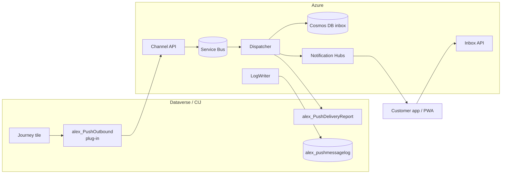

# Implementer guide

This guide is for a partner or developer who takes over the Push + Inbox channel and deploys it for a customer. It follows the end-to-end path in order and links to the reference docs for details, so it doesn't repeat them.

Each statement is labelled **Verified** (tested end to end with the reference PWA in a test environment) or **Unverified**. Unlabelled statements come from the linked Microsoft documentation.

## 1. What you deploy

| Part | Delivered as | Reference |
|---|---|---|
| Dataverse solution: channel definition, message parts, configuration table, custom APIs, plug-in, environment variable, message log, two roles | `release/<version>/` packages | [release notes](../release/README.md), [data model](data-model.md) |
| Azure backend | `azd up` template (`azure.yaml`, `infra/`, `src/PushInbox.Functions`) | [architecture](architecture.md) |
| Reference PWA (test harness) | Published by `azd up` to Static Web Apps | [developer integration](developer-integration.md) |
| Post-install scripts | `deploy/post-import.sh`, `deploy/connect-azure.sh` | [installation](installation.md) |

## 2. Prerequisites and licenses

| Need | Why | Reference |
|---|---|---|
| A Dataverse environment with **Customer Insights - Journeys** installed and licensed | Custom channels are a CIJ feature. | [Custom channels in CIJ](https://learn.microsoft.com/dynamics365/customer-insights/journeys/real-time-marketing-extend-outreach-custom-channels), [Dynamics 365 licensing guide](https://go.microsoft.com/fwlink/?LinkId=866544) |
| **Dataverse log capacity** | The message log is an elastic table, and its rows count against log capacity. | [Capacity](https://learn.microsoft.com/power-platform/admin/capacity-storage), [data model §8.7](data-model.md#87-elastic-limitations-that-matter-here) |
| **System Administrator** in the environment | To import the solution, create the application user and grant roles. | [installation](installation.md#prerequisites) |
| An **Azure subscription**, with Owner or User Access Administrator on it | The template creates resources and role assignments. | [installation §4](installation.md#4-deploy-the-azure-backend) |
| Tools: `pac`, `az`, `azd`, .NET 10 SDK, Node.js, Python 3 | Packaging, deployment, scripts and VAPID keys. | [installation](installation.md#prerequisites) |
| Optional: **Hebrew** enabled in the environment | For the Hebrew (right-to-left) labels. | [localization](localization.md) |
| Optional: Microsoft **Fabric** capacity, or Azure Synapse Link | Only for reporting option C on the message log. | [Link to Fabric](https://learn.microsoft.com/power-apps/maker/data-platform/fabric-link-to-data-platform) |

**Azure costs.** The development template uses Free and consumption tiers. For production tiers, including Notification Hubs Standard for per-message telemetry, see [production sizing](production-sizing.md).

## 3. End-to-end path

| # | Step | How | Verify |
|---|---|---|---|
| 1 | Choose the package | Managed for test and production; unmanaged only for development ([installation §1](installation.md#1-get-the-solution-package)). | — |
| 2 | Import the solution | `pac solution import --environment <url> --path …` ([installation §2](installation.md#2-import)) | The solution shows version 1.1.0.0. |
| 3 | Grant CIJ read access | `deploy/post-import.sh <url>` ([installation §3](installation.md#3-grant-cij-read-access-to-the-channel-configuration)) | The script prints OK. A warning about a locked Cxp role is expected. |
| 4 | Deploy Azure | `azd env new` and `azd env set …` (including the VAPID keys), then `azd up` ([installation §4](installation.md#4-deploy-the-azure-backend)) | Outputs `API_BASE_URL` and `WEB_URL`. |
| 4a | Optional: native credentials | Only for your own Android or iOS app: add FCM v1 and/or APNs (token) credentials to the hub ([installation §4.4](installation.md#44-native-push-credentials-android-and-ios)). | Settings show the credential. |
| 5 | Connect Dataverse and Azure | `deploy/connect-azure.sh <url>`. This sets the environment variable and creates the app user with **Basic User** and **Push Inbox Log Writer** ([installation §4.3](installation.md#43-connect-dataverse-to-azure)). | The app user exists with both roles. |
| 6 | Create the channel instance | In CIJ settings, add **Push + Inbox** with an **App key** ([configuration](configuration.md#channel-instance-push-sender)). | The *Push sender* form opens. |
| 7 | Assign the reader role | Give **Push Inbox Log Reader** to marketers who read the log. | They see *Push message logs* rows. |
| 8 | Subscribe a test browser | Open `WEB_URL?appKey=<app key>&recipientKey=contact_<contact id>` (the contact your test journey targets) and select **Subscribe** ([installation §5](installation.md#5-configure-cij-and-run-the-first-test)). | The trace `Browser installation … registered`. |
| 9 | Test send | Test send from the message editor. The recipient key is the value you type in the test-send box, so type the same `contact_<contact id>`. | A notification and an inbox item arrive. No delivery report is sent for test sends. **Verified.** |
| 10 | Journey send | A minimal journey with a Push + Inbox tile, sent to the contact from step 8. Journey sends use `contact_<contact id>` as the recipient key ([developer integration, identifiers](developer-integration.md#identifiers)). | The trace `Delivery report Delivered sent for request …`. After tens of minutes, the tile shows Sent/Delivered. **Verified.** |
| 11 | Tap | Set the **Tap action link** to the app URL, then send and tap the notification. | The app opens on the message. A *Clicked* log row is written, and CIJ shows *Unique clicks* after the latency. **Verified.** |

The list of verification calls is in [installation §6](installation.md#6-verify).

## 4. Message authoring rules for marketers

The message parts are described in [configuration](configuration.md#message-parts). These rules matter in practice:

- **Tap action link = your app's URL, the same for every recipient.**
  - Use the PWA URL, an Android App Link or an iOS Universal Link, for example `https://<your-app>/`.
  - Never put a recipient key or contact ID in it. The message is the same for everyone, and the app already knows its recipient from device registration.
  - CIJ wraps the link in a tracked link, so a tap counts as a click and lands in the app. **Verified for the PWA.**
- **External links go in the body, as full `https://` URLs.**
  - They're tracked separately and show their own Target URL in analytics. **Verified.**
  - `www.…` links without a scheme aren't tracked or linked.
- **Delivery mode** sets whether the message is a push, an inbox item or both.
- **Replace key** replaces the earlier inbox item that has the same key.
- **Image** must be an image from the asset library.

## 5. Client integration

What a customer app must do, with code: [developer integration](developer-integration.md).

| Platform | Status |
|---|---|
| Web / PWA (Push API + VAPID via Notification Hubs) | Implemented and **verified**: Microsoft Edge on desktop; Chrome and Samsung Internet on Android. |
| iOS web push | Needs a Home Screen web app on iOS/iPadOS 16.4+ ([WebKit](https://webkit.org/blog/13878/web-push-for-web-apps-on-ios-and-ipados/)). **Unverified** in this solution. |
| Native Android (FCM v1) and iOS (APNs) | Backend implemented: `POST /devices` registers FCM v1 and APNs tokens, and the Dispatcher sends to every platform. **Verified** without devices: installations, payloads (unit tests), and skipping a platform that has no credentials. **Unverified:** delivery to a real device; there is no reference native app. You add the FCM v1 and APNs credentials to your hub ([installation §4.4](installation.md#44-native-push-credentials-android-and-ios)); the app contract is in [developer integration §1](developer-integration.md#native-apps-registration-contract-backend-implemented-clients-untested) and [§3](developer-integration.md#3-how-to-report-clicks). |

Before production, the Inbox API **must** get end-user authentication. It is anonymous in this repository ([developer integration: What must change for production](developer-integration.md#what-must-change-for-production), [SEC-10](security.md#sec-10-inbox-api-end-user-authentication-and-authorization)).

## 6. What CIJ sees, and what the log adds

| Event | Source | CIJ analytics / journey | Message log (`alex_pushmessagelog`) |
|---|---|---|---|
| Sent | The Channel API accepts the send. | *Sent* | Sent row |
| Delivered / not delivered | The Dispatcher reports through `alex_PushDeliveryReport`. | *Delivered* (**verified**): the entry moves from Processing to Processed, and *If/then: Delivered* applies. NotDelivered is expected to show as *Delivery failed*; **unverified**. | Delivered / NotDelivered row, with a reason |
| Click on the tap or a body link | CIJ tracked link | *Unique / Total clicks* with Target URL; *If/then: Link Clicked* **Verified** | Clicked row, when the app calls `POST /inbox/{id}/click` |
| Inbox read | `POST /inbox/{id}/read` | Not reported | Read row |
| Blocked notifications | — | Not reported | Not logged |

- **Delivered** means the inbox item was stored or Notification Hubs accepted the push. It doesn't mean the device displayed it.
- How the reports are built: [architecture: Send flow](architecture.md#send-flow).
- Clicks in detail: [developer integration §3](developer-integration.md#3-how-to-report-clicks).
- Which report status, if any, produces CIJ's *Blocked* and *Bounced* categories is **unverified**.

## 7. The message log and what partners can build

The solution ships an append-only **event log**, one row per event, as the reference record. It contains no message content, and rows are deleted by TTL: 180 days for real sends and 7 days for test sends. Both are configurable.

What to build on top depends on the customer:
- **A.** Use the log as is, through views.
- **B.** A summary table, one row per message × contact.
- **C.** Fabric / Synapse Link and Power BI.
- **D.** CIJ's own interaction data.

Schema, write path, retention and the trade-offs of each option: [data model §8](data-model.md#8-message-log-elastic-table-alex_pushmessagelog).

**Segments from push events** (who clicked, who read, …): journey branching on CIJ's custom-channel interactions works today. Using the log in real-time segments is unverified; a small standard summary table is the documented fallback. *Blocked* isn't available. See [data model §8.9](data-model.md#89-building-segments-from-push-events). Privacy: [SEC-19](security.md#sec-19-message-log-in-dataverse).

## 8. Operate

- **Monitoring.** Use Application Insights traces for each message ([troubleshooting](troubleshooting.md#trace-messages-for-one-send)). Also watch the Service Bus dead-letter counts on `dispatch` and `messagelog`. Dead-letter alerting isn't shipped.
- **Secrets.** See [configuration: Azure keys and secrets](configuration.md#azure-keys-and-secrets) and [security](security.md).
- **Sizing.** See [production sizing](production-sizing.md).
- **Problems.** See [troubleshooting](troubleshooting.md).

## 9. Upgrade, uninstall and limitations

- [Upgrade](installation.md#upgrade) and [uninstall](installation.md#uninstall)
- [Known limitations](known-limitations.md)
- [Security considerations](security.md), including the [summary of open items](security.md#summary-of-open-items)

## 10. Customizing

- **Development.** Work in the unmanaged package, or from source with `pac solution pack`. Keep English and Hebrew labels on every component: the pre-commit hook runs `tests/solution/check_solution.py` ([localization](localization.md), [CONTRIBUTING](../CONTRIBUTING.md)).
- **Publisher prefix.** The prefix is `alex`. Changing it means renaming every component. Keep it unless you fork the solution under your own publisher ([Solution publisher](https://learn.microsoft.com/power-platform/alm/solution-concepts-alm#solution-publisher)).
- **Releasing.** Export your own managed package from your development environment, under a new version number.
